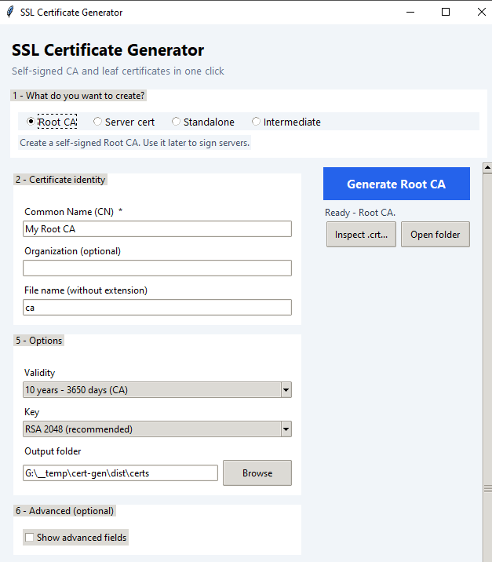
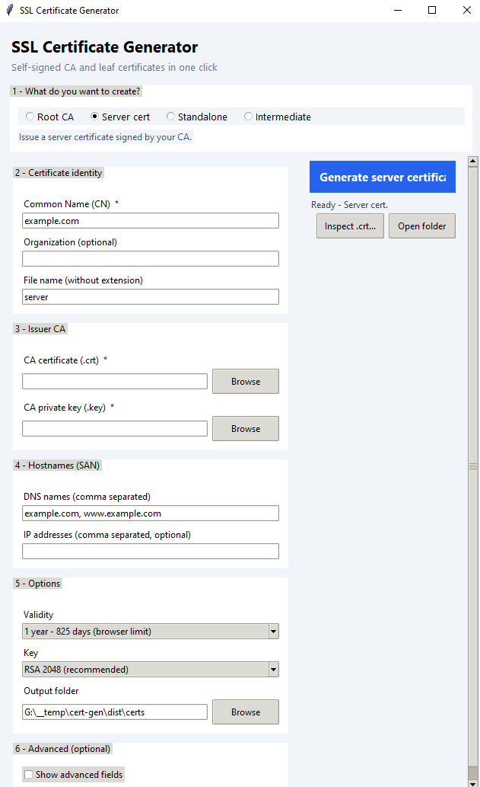
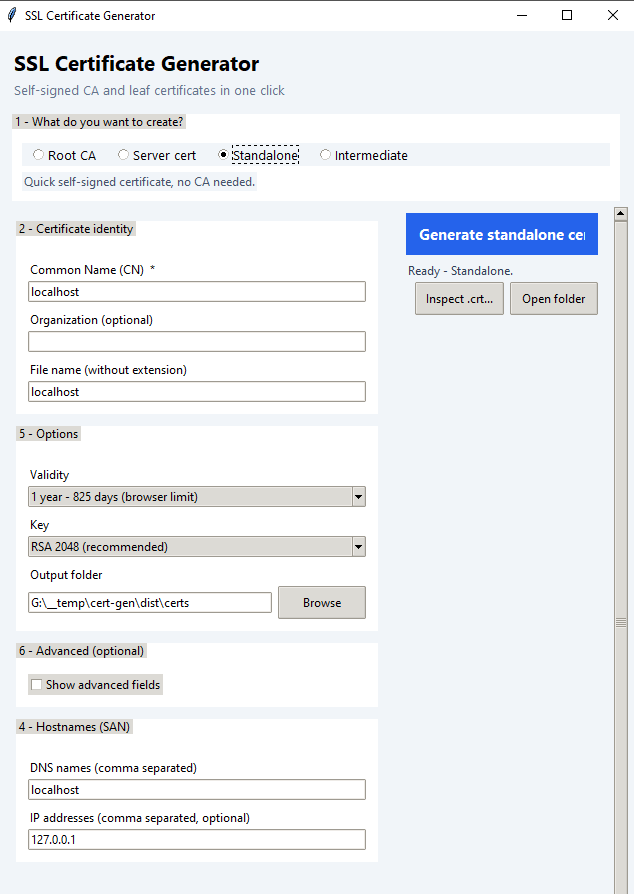
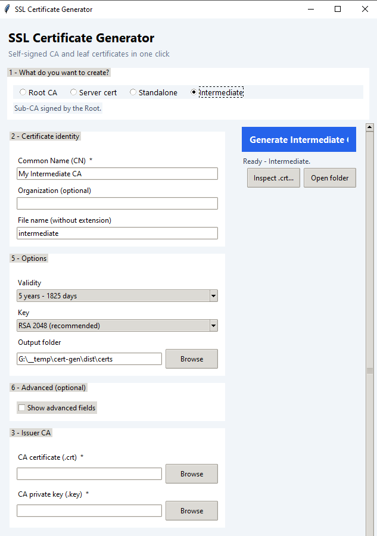

# Self-Signed SSL Certificate Generator

A small GUI tool for creating SSL certificates, written in pure Python
(`cryptography` only - no `openssl` binary needed). It can create:

- A self-signed **Root CA**
- A **server certificate** signed by your CA
- An **intermediate CA** under the Root
- A **standalone** self-signed certificate for quick testing

## Quick start

```bat
pip install -r requirements.txt
python cert_gui.py
```

## The four certificate types

At the top of the window, pick what you want to create. The form changes to
match your choice.

### 1. Root CA



Creates the certificate authority that signs all your other certificates.
Use a name like `My Root CA` for CN, keep **10 years** validity, and use
file name `ca`. You get `ca.key` (secret) and `ca.crt` (install this on
machines to trust your certificates).

### 2. Server cert



Issues a certificate for a domain, signed by your Root CA. Pick `ca.crt`
and `ca.key` in the **Issuer CA** section, set CN to the domain
(e.g. `example.com`), and list all names under **SAN DNS**
(e.g. `example.com, www.example.com`). Output: `server.key`, `server.crt`,
and `server.chain.crt` (server cert + CA).

### 3. Standalone



One self-signed certificate with no CA - useful for quick local tests.
Set CN to `localhost`, SAN DNS to `localhost`, and SAN IP to `127.0.0.1`.

### 4. Intermediate



A sub-CA signed by the Root, for larger setups. Pick the Root certificate
and key in the **Issuer CA** section, then use the resulting Intermediate
files to sign server certificates instead of the Root.

## Common fields

| Field            | What to enter                                                        |
|------------------|----------------------------------------------------------------------|
| Common Name (CN) | Domain for a server (e.g. `example.com`), or a name for a CA         |
| San DNS / SAN IP | All extra names and IPs the certificate should be valid for          |
| Validity         | 1 year (825 days) for servers, up to 10 years for a CA               |
| Key              | `RSA 2048` is fine; `RSA 4096` stronger; `EC P-256` faster           |
| Output folder    | Where files are saved (default `certs`)                              |

Click **Show advanced fields** for country, state, city, email, and key
passwords.

## Trusting the CA

To stop the browser warning, install **`ca.crt`** once per machine:

1. Double-click `ca.crt` -> **Install Certificate**
2. Choose **Local Machine** -> **Place all certificates in the following store**
3. Choose **Trusted Root Certification Authorities** -> Finish
4. Restart the browser

Or from an administrator PowerShell:

```powershell
Import-Certificate -FilePath .\certs\ca.crt -CertStoreLocation Cert:\LocalMachine\Root
```

## Useful buttons

- **Open folder** - opens the output folder
- **Inspect .crt** - shows Subject / Issuer / dates / SAN of any certificate
- **build-exe.bat** - builds `dist\SSLCertGen.exe` with PyInstaller

## Troubleshooting

| Problem                                | Fix                                                        |
|----------------------------------------|------------------------------------------------------------|
| `CN field is required`                 | CN is mandatory - fill it in                               |
| `Select the issuer CA certificate and key` | For Server cert / Intermediate, pick `ca.crt` and `ca.key` first |
| Browser still says "not secure"        | Install `ca.crt` in **Trusted Root** and restart the browser |
| Warning on a subdomain                 | Add the subdomain to **SAN DNS** and re-issue the certificate |

## Security notes

- `.key` files are **secret** - never share or commit them (`.gitignore`
  already ignores them).
- This tool is for internal use, development, and testing. For public
  websites use a trusted authority such as Let's Encrypt.
